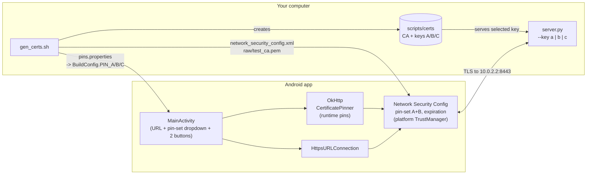
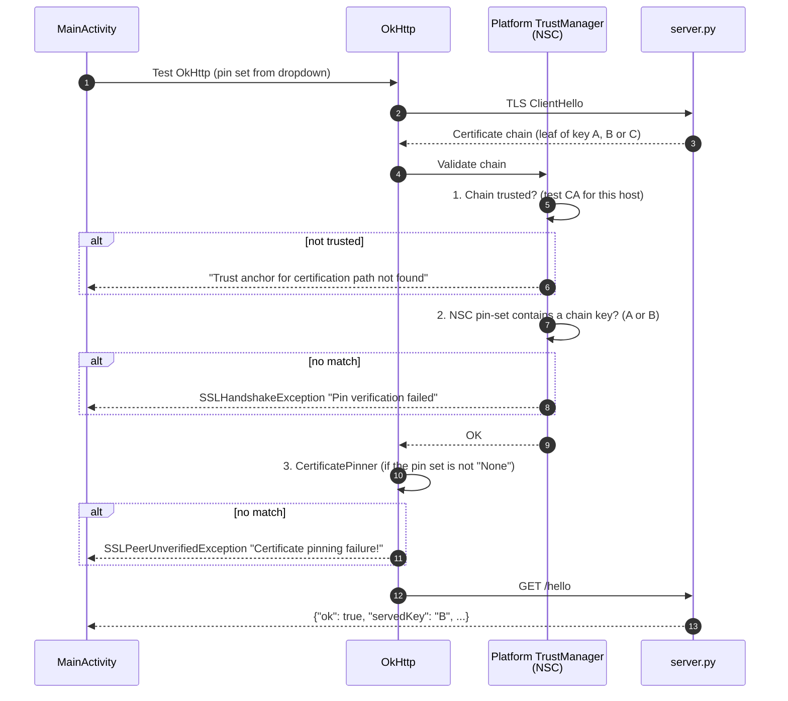
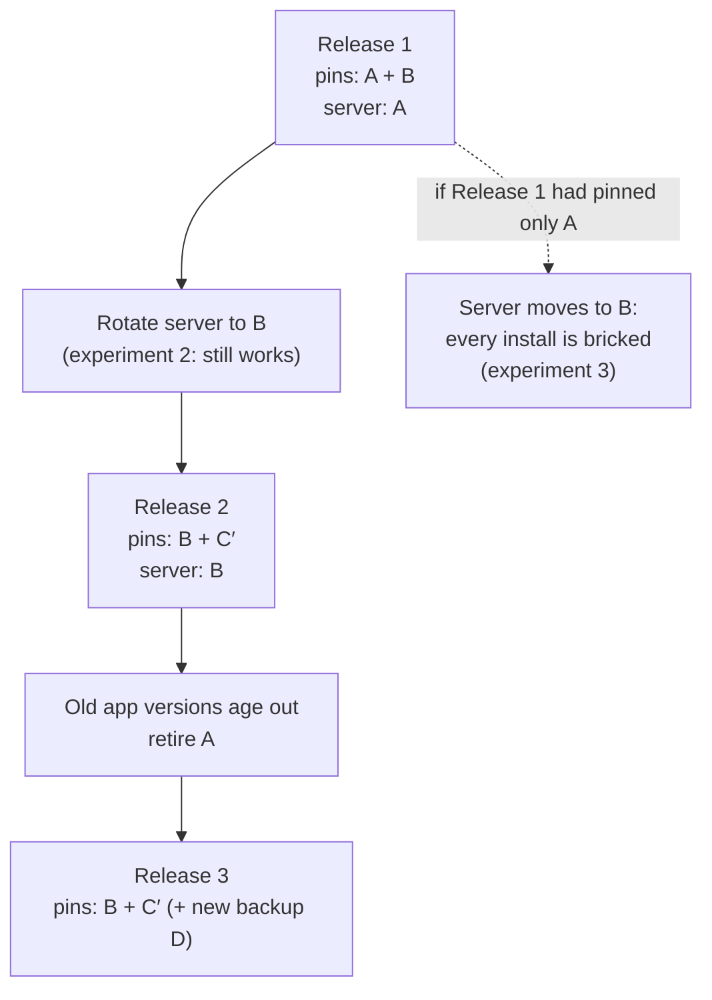
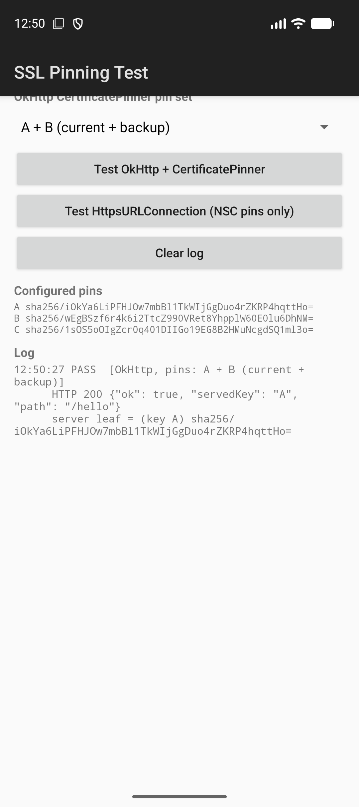
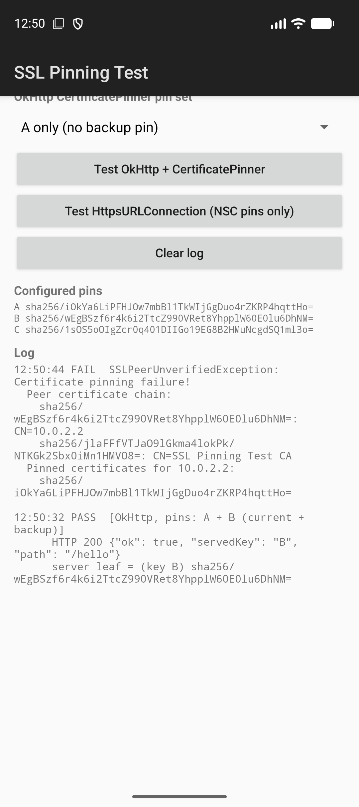
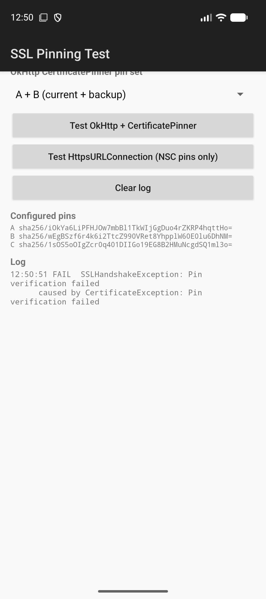

# SSL Pinning & Key Rotation Sample (Android)

A small Kotlin app plus a local HTTPS server for experimenting with **public-key (SPKI) pinning** and **server key rotation**. It lets you flip the server between three keys and the app between several pin sets. You can then see which combinations connect, which fail, and which layer rejected the connection.

- [Background: why pinning, and why rotation is the hard part](#background)
- [What's in the repo](#whats-in-the-repo)
- [How it works](#how-it-works)
- [Run it](#run-it)
- [The experiments (test matrix)](#the-experiments-test-matrix)
- [Reading the results](#reading-the-results)
- [Rotation playbook](#rotation-playbook-what-this-sample-models)
- [Screenshots](#screenshots)
- [Caveats](#caveats)

---

## Background

### The problem pinning solves

TLS normally trusts any certificate that chains to a CA in the device's trust store. That is a large set of CAs, and it can be extended. A user can install a corporate or debugging CA, malware can install one, and any CA can mis-issue a certificate. In all of those cases a man-in-the-middle (MITM) presents a certificate your app accepts as valid.

**Pinning** adds a second check. The app also requires that the server's public key matches one the developer shipped inside the app. A certificate from a trusted CA is no longer enough.

### Pinning the public key (SPKI), not the certificate

A certificate expires and gets re-issued every few months. The key pair behind it can stay the same. Pinning the SHA-256 hash of the **SubjectPublicKeyInfo (SPKI)** survives routine certificate renewal, as long as the key doesn't change.

```
pin = base64( sha256( SubjectPublicKeyInfo DER ) )      e.g.  sha256/iOkYa6LiPFHJOw7mbBl1TkWIjGgDuo4rZKRP4hqttHo=
```

### The real risk: rotation

Pinning has a failure mode that is worse than the attack it prevents. **If the server switches to a key the app doesn't know, every installed copy of the app stops working** until users update. There are two ways to avoid this:

1. **Ship a backup pin ahead of time.** The app pins the current key (A) and a not-yet-deployed backup key (B). Rotating the server to B then needs no app update.
2. **Plan for expiry.** Android's Network Security Config can stop enforcing pins after a date, so very old installs fail open instead of staying broken forever.

This repo is a sandbox for proving that those two mechanisms work. It also shows what breaks when they're missing.

---

## What's in the repo

```
.
├── pins.properties                  # GENERATED: host, port and the three pins (A, B, C)
├── scripts/
│   ├── gen_certs.sh                 # creates test CA + keys A/B/C + certs, writes pins into the app
│   ├── server.py                    # tiny HTTPS server; --key a|b|c picks which key it serves
│   └── certs/                       # GENERATED: ca.pem, key_{a,b,c}.pem, cert_{a,b,c}.pem
└── app/
    ├── build.gradle.kts             # reads pins.properties -> BuildConfig.PIN_A/B/C, TEST_HOST, TEST_PORT
    └── src/main/
        ├── AndroidManifest.xml      # points the app at the Network Security Config
        ├── java/.../MainActivity.kt # the whole UI + the two pinning tests
        └── res/
            ├── raw/test_ca.pem      # GENERATED: the test CA, trusted for the test host only
            └── xml/network_security_config.xml  # GENERATED: NSC pin-set (A + B)
```

### The three keys

`gen_certs.sh` creates one local test CA and three server keys. Each key gets a certificate signed by that CA, so **all three certificates are fully valid and trusted**. They differ only in whether the app pins their key.

| Key | Role | Pinned in NSC? | Simulates |
|-----|------|----------------|-----------|
| **A** | Current production key | ✅ | The server today |
| **B** | Backup / next key | ✅ | The planned rotation target |
| **C** | Rogue key | ❌ | A mis-issued or MITM certificate from a trusted CA |

---

## How it works

### Components



The generator is the single source of truth. One run produces the keys and writes the matching pins and CA into the app, so the two sides can't drift apart.

### The two pinning layers

The app exercises two different ways to pin:

| Layer | Configured in | Pins | Applies to |
|-------|---------------|------|-----------|
| **OkHttp `CertificatePinner`** | `MainActivity.kt` | Chosen **at runtime** from a dropdown: A+B, A only, B only, C only, none | OkHttp calls only |
| **Network Security Config (NSC)** | `res/xml/network_security_config.xml` | **Fixed at build time**: A + B, with an `expiration` date | **Every** connection that uses the platform `TrustManager`, including OkHttp *and* `HttpsURLConnection` |

Because NSC sits underneath OkHttp, an OkHttp request has to pass **both** layers. This is why the "None (NSC only)" option exists. It turns off the OkHttp layer so you can see NSC alone.

### What happens on each request



The **Test HttpsURLConnection** button follows the same path but stops after step 2. It has no OkHttp layer.

### The app

The UI is built in code in `MainActivity.kt`, with no layouts or Compose. It looks roughly like this:

```
┌─────────────────────────────────────────┐
│ SSL Pinning Test                        │
├─────────────────────────────────────────┤
│ Server URL                              │
│ [ https://10.0.2.2:8443/hello         ] │
│ OkHttp CertificatePinner pin set        │
│ [ A + B (current + backup)          ▾ ] │
│ [ Test OkHttp + CertificatePinner     ] │
│ [ Test HttpsURLConnection (NSC only)  ] │
│ [ Clear log                           ] │
│ Configured pins                         │
│ A sha256/iOkY...  B sha256/wEgB...  ... │
│ Log                                     │
│ 12:01:09 PASS  [OkHttp, pins: A + B]    │
│       HTTP 200 {"ok": true, "servedKey" │
│       : "B", ...}                       │
│       server leaf = (key B) sha256/...  │
└─────────────────────────────────────────┘
```

Each tap builds a **new** `OkHttpClient`, so the connection pool is empty and every test does a real TLS handshake. The HttpsURLConnection test sends `Connection: close` for the same reason. On success the log prints which key the server actually presented (`server leaf = (key B)`), so you can confirm the server really rotated.

### The server

`server.py` is a ~50-line `ThreadingHTTPServer` wrapped in TLS. It loads `certs/cert_<key>.pem` and `certs/key_<key>.pem` and answers any GET with JSON like `{"ok": true, "servedKey": "B", "path": "/hello"}`. **Rotation is simulated by stopping it (Ctrl+C) and starting it again with a different `--key`.**

---

## Run it

**Prerequisites:** Android Studio (Ladybug or newer), an emulator on API 24 or newer, `python3`, and `openssl`.

```bash
# 1. (Optional) regenerate keys. The repo already ships keys for the emulator (10.0.2.2).
./scripts/gen_certs.sh                  # emulator
./scripts/gen_certs.sh 192.168.1.20     # physical device: use your computer's LAN IP

# 2. Start the server with the current key
python3 scripts/server.py --key a
```

1. Open the project in Android Studio and let Gradle sync.
2. Run the app on the emulator.
3. Pick a pin set, tap a test button, and read the log.
4. To rotate, stop the server and restart it with `--key b` (or `--key c`). Then tap again. You don't need to touch the app.

> **Rebuild the app whenever you re-run `gen_certs.sh`.** It rewrites `pins.properties`, the NSC XML and `res/raw/test_ca.pem`.
>
> On a physical device, make sure the phone and computer are on the same network, and that the firewall allows port 8443.

`10.0.2.2` is the emulator's alias for the host machine's `localhost`.

---

## The experiments (test matrix)

Each row is one experiment: start the server with the **Server key**, choose the **OkHttp pin set** in the dropdown, and tap the button.

| # | Server key | OkHttp pin set | Expected | What it proves |
|---|-----------|----------------|----------|----------------|
| 1 | A | A + B | ✅ pass | Normal operation |
| 2 | **B** | **A + B** | ✅ pass | **Rotation works because the backup pin shipped ahead of time** |
| 3 | B | A only | ❌ `Certificate pinning failure!` | An app without a backup pin breaks when the server rotates |
| 4 | A | B only | ❌ `Certificate pinning failure!` | A post-rotation build that dropped the old pin too early breaks against servers still on A |
| 5 | C | A + B (or any) | ❌ fail | A trusted-but-unpinned cert (MITM or mis-issuance) is blocked |
| 6 | C | None (NSC only) | ❌ `Pin verification failed` | NSC catches it even with no OkHttp pins |
| 7 | B | None (NSC only) | ✅ pass | The NSC backup pin works on its own |
| 8 | C | C only | ❌ `Pin verification failed` | OkHttp would accept C, but **NSC still blocks it**. The layers stack, so the stricter one wins. |

Experiment 8 is the one people tend not to expect. Pinning key C in OkHttp doesn't help, because C was never in the NSC pin-set.

Also try: tap **Test HttpsURLConnection** with the server on A, B and C. It should pass for A and B and fail for C, because only NSC applies to it.

---

## Reading the results

The error message tells you which layer rejected the connection:

| Log message | Rejected by |
|-------------|-------------|
| `SSLPeerUnverifiedException: Certificate pinning failure!` | **OkHttp `CertificatePinner`**. The message lists the server's actual pins. |
| `SSLHandshakeException … Pin verification failed` | **NSC `pin-set`** |
| `Trust anchor for certification path not found` | The chain isn't trusted at all (wrong CA, wrong host, or CA not installed) |
| `PASS … server leaf = (key X) sha256/…` | Everything passed, and this is the key the server presented |

### Checking from the command line

You can reproduce the pin check without the app:

```bash
python3 scripts/server.py --key b &
curl --cacert scripts/certs/ca.pem \
     --pinnedpubkey "sha256//<PIN_A>;sha256//<PIN_B>" \
     https://127.0.0.1:8443/hello       # exit code 90 = pin mismatch
```

Take `<PIN_A>` and `<PIN_B>` from `pins.properties`, without the `sha256/` prefix.

To compute a pin yourself, which is what `gen_certs.sh` does:

```bash
openssl pkey -in scripts/certs/key_a.pem -pubout -outform der \
  | openssl dgst -sha256 -binary | openssl enc -base64
```

---

## Rotation playbook (what this sample models)



1. **Ship backup pins early.** Every release pins the current key (A) and at least one backup key (B). Generate B ahead of time and keep it offline.
2. **Rotate the server** to B. Existing installs keep working because B is already pinned.
3. **Ship a release that pins B plus a new backup C′.** Keep A until you're sure no server still uses it.
4. **Retire A** once old app versions have aged out.
5. **Set an NSC `expiration`** so very old, unupdated installs fail open instead of being permanently bricked.

Pinning an intermediate or root CA key instead of the leaf key is an alternative. It is less brittle, but it gives weaker guarantees, because any certificate that CA issues will match.

---

## Screenshots

Captured from the emulator while running the experiments above.

| | |
|---|---|
| **Experiment 1: key A, pins A + B.** Passes. | **Experiment 2: server rotated to B, pins A + B.** Passes because B was pinned ahead of time. |
|  |  |
| **Experiment 3: server on B, pins "A only".** OkHttp rejects it and lists the server's actual pin. | **Experiment 5: server on rogue key C.** The NSC rejects a CA-trusted but unpinned key. |
|  |  |

The app on first launch: [docs/media/01-initial.png](docs/media/01-initial.png).

### Capturing more

```bash
adb exec-out screencap -p > docs/media/my-shot.png

# Screen recording (stop with Ctrl+C, max 3 minutes)
adb shell screenrecord /sdcard/rotation.mp4 && adb pull /sdcard/rotation.mp4 docs/media/
```

A good demo recording: server on A, test passes. Restart the server on B, test passes (experiment 2). Switch to "A only", test fails (experiment 3). Restart the server on C, test fails (experiment 5).

---

## Caveats

- **The private keys in `scripts/certs/` are committed on purpose.** They are throwaway test keys and protect nothing. Never reuse this CA or these keys outside the sandbox.
- The test CA is trusted only for the test host through the NSC `domain-config`. It isn't installed on the device.
- NSC requires API 24 or newer, which is why `minSdk` is 24.
- The NSC `expiration` is set to one year after generation. After that date Android stops enforcing the NSC pins (fail-open), and the NSC experiments will behave differently. Regenerate to reset it.
- `gen_certs.sh` leaf certificates are valid for 397 days and the CA for 825 days. Regenerate if TLS starts failing with an expiry error.
- Two layers are pinned on purpose here, so you can compare them. In a real app, pick one mechanism, or keep both in sync. A mismatch between them is a common source of rotation outages.
